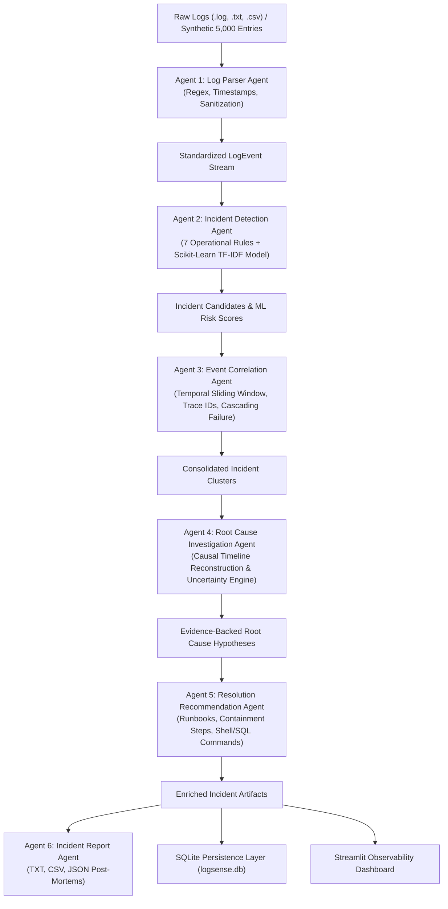

# LogSense AI — Agentic Log Analysis & Incident Intelligence Platform

[](https://www.python.org/downloads/)
[](https://opensource.org/licenses/MIT)
[](https://streamlit.io/)
[](https://scikit-learn.org/)
[](https://docs.pytest.org/)

**LogSense AI** is a production-grade, local-first **Agentic AI platform** for automated application log analysis, operational incident detection, multi-service event correlation, evidence-based root cause investigation, and actionable troubleshooting runbook synthesis.

Designed with modern observability aesthetics (inspired by Datadog, Dynatrace, and Grafana), LogSense AI replaces manual grep and brittle log queries with an orchestrated hierarchy of six specialized Python agents working over shared operational telemetry.

---

## 🌟 Key Features

- **6 Specialized AI Agents**:
  1. 📥 **Log Parser Agent**: Ingests unstructured `.log`, `.txt`, and tabular `.csv` files; extracts ISO/custom timestamps, log levels, service boundaries, HTTP endpoints, status codes, response latencies, and trace IDs.
  2. 🔍 **Incident Detection Agent**: Evaluates 7 operational rules (database pool saturation, HTTP 5xx cascades, latency SLA breaches, unhandled exceptions, brute-force auth spikes, container crashes) combined with a supervised **Scikit-Learn TF-IDF classifier** with reported validation metrics (Accuracy, Precision, Recall, F1).
  3. 🔗 **Event Correlation Agent**: Clusters anomalies into consolidated incident entities using sliding temporal windows (±5 minutes), service topology, HTTP endpoints, and cross-service failure cascades.
  4. 🔬 **Root Cause Investigation Agent**: Formulates evidence-supported root cause hypotheses based on chronological log telemetry. **Adheres strictly to scientific rigor**: hypotheses are designated as *Possible Causes* (never claimed confirmed without direct proof) and explicitly quantify diagnostic uncertainty when logs are sparse.
  5. 🛠️ **Resolution Recommendation Agent**: Prescribes actionable troubleshooting runbooks prioritized by urgency (Immediate Containment, Short-term Remediation, Preventive Architectural Fixes) with copy-ready diagnostic shell/SQL commands.
  6. 📑 **Incident Report Agent**: Compiles formal audit post-mortems in Plain Text (`.txt`), Tabular Data (`.csv`), and structured JSON formats.

- **Local-First & Offline**: 100% self-contained. No external LLM downloads, no GPU requirement, no cloud API keys, and zero internet requests during runtime. Runs comfortably under strict bandwidth and resource budgets (<2 GB).
- **SQLite Database Persistence**: Stores analysis sessions, incidents, correlated event streams, agent execution audits, and engineer sign-off reviews with investigator notes.
- **Interactive Observability Dashboard**:
  - Dark mode glassmorphic UI with KPI cards.
  - Interactive Plotly visualizations (Severity donut, service failure breakdown, category frequency, event timeline histogram).
  - Searchable and filterable log viewer with severity badges.
  - Multi-agent inspection panel exposing agent execution times, inputs, outputs, and ML model performance.
  - One-click **Demo Log Generator** (~5,000 multi-service logs covering real-world outage scenarios).

---

## 🏗️ System Architecture



---

## 📂 Project Directory Structure

```
LogSense-AI/
├── app.py                          # Streamlit Observability Dashboard
├── requirements.txt                # Essential lightweight dependencies
├── README.md                       # Documentation and usage guide
├── .gitignore                      # Git exclusion rules
├── data/
│   ├── sample_logs.log             # 5,000-line realistic demo log dataset
│   └── logsense.db                 # SQLite persistence database (auto-generated)
├── src/
│   ├── __init__.py
│   ├── models.py                   # Dataclasses: LogEvent, Incident, AgentResult, Session
│   ├── log_parser.py               # Agent 1: Log parsing & sanitization
│   ├── incident_detector.py        # Agent 2: Rules & Scikit-Learn ML classifier
│   ├── event_correlator.py         # Agent 3: Temporal & topological clustering
│   ├── root_cause.py               # Agent 4: Causal timeline & uncertainty quantification
│   ├── recommendations.py          # Agent 5: Diagnostic & mitigation runbooks
│   ├── agent_orchestrator.py       # Central pipeline coordinator & state management
│   ├── report_generator.py         # Agent 6: TXT, CSV, JSON export compiler
│   ├── database.py                 # SQLite storage & review workflow
│   └── synthetic_generator.py      # Demo log synthesizer (5,000 records)
└── tests/
    ├── __init__.py
    ├── test_log_parser.py          # Parser verification tests
    ├── test_incident_detector.py   # Heuristic & ML detection tests
    ├── test_event_correlator.py    # Temporal clustering & cascade tests
    ├── test_root_cause.py          # Causal reasoning & uncertainty tests
    ├── test_recommendations.py     # Troubleshooting runbook tests
    └── test_report_generator.py    # Report compilation & SQLite persistence tests
```

---

## 🚀 Quickstart & Installation

### 1. Prerequisites
- Python 3.10, 3.11, 3.12, or 3.13 installed.
- Git (optional, for version control).

### 2. Clone and Setup
```bash
# Clone the repository
git clone https://github.com/your-username/logsense-ai.git
cd logsense-ai

# Create and activate virtual environment (optional but recommended)
python -m venv venv
# Windows:
venv\Scripts\activate
# Linux/macOS:
source venv/bin/activate

# Install lightweight dependencies
pip install -r requirements.txt
```

### 3. Run the Dashboard
```bash
streamlit run app.py
```
Open your browser at `http://localhost:8501`.

### 4. Run the Test Suite
```bash
python -m pytest -v
```

---

## 🧪 Testing Results

All 19 automated unit tests validate the complete pipeline:
```
============================= test session starts =============================
tests/test_event_correlator.py::test_correlate_by_trace_id PASSED
tests/test_event_correlator.py::test_correlate_cascading_database_failure PASSED
tests/test_incident_detector.py::test_detect_database_failure PASSED
tests/test_incident_detector.py::test_detect_http_500 PASSED
tests/test_incident_detector.py::test_detect_slow_api_request PASSED
tests/test_incident_detector.py::test_detect_unhandled_exception PASSED
tests/test_incident_detector.py::test_detect_suspicious_auth_burst PASSED
tests/test_incident_detector.py::test_ml_model_evaluation_metrics PASSED
tests/test_log_parser.py::test_parse_standard_text_log PASSED
tests/test_log_parser.py::test_parse_json_lines_log PASSED
tests/test_log_parser.py::test_parse_csv_log PASSED
tests/test_log_parser.py::test_parse_empty_content PASSED
tests/test_log_parser.py::test_parse_malformed_lines_gracefully PASSED
tests/test_recommendations.py::test_recommendations_database_incident PASSED
tests/test_recommendations.py::test_recommendations_auth_attack PASSED
tests/test_report_generator.py::test_report_generation_formats PASSED
tests/test_report_generator.py::test_database_persistence_and_retrieval PASSED
tests/test_root_cause.py::test_root_cause_database_pool_exhaustion PASSED
tests/test_root_cause.py::test_root_cause_uncertainty_handling_for_sparse_logs PASSED
======================= 19 passed in 2.17s =======================
```

---

## 📖 Operational Playbook & Usage

1. **Quick Evaluation**: Click **"Generate Demo Logs (5,000)"** in the left sidebar. The system creates realistic logs across 7 services with 5 outage patterns, executes all 6 agents, and populates the dashboard in ~2 seconds.
2. **Upload Custom Logs**: Navigate to **"Upload Logs"** to upload your application's `.log` or `.csv` files.
3. **Explore Incidents**: In **"Incident Explorer"**, filter by severity (Critical, High, Medium, Low) or service. Mark incidents as reviewed and record on-call notes.
4. **Inspect Agents & ML**: In **"Agent Workflow"**, view the execution time, input/output summary, and Scikit-Learn evaluation metrics (Accuracy, Precision, Recall, F1).
5. **Root Cause Analysis**: In **"Root Cause Analysis"**, inspect evidence lines, causal propagation chains, diagnostic uncertainty notes, and copy-ready troubleshooting shell/SQL commands.
6. **Download Reports**: In **"Reports & Export"**, download post-mortem documentation in TXT, CSV, or JSON.

---

## 🛡️ License

Distributed under the MIT License. See `LICENSE` for more information.
